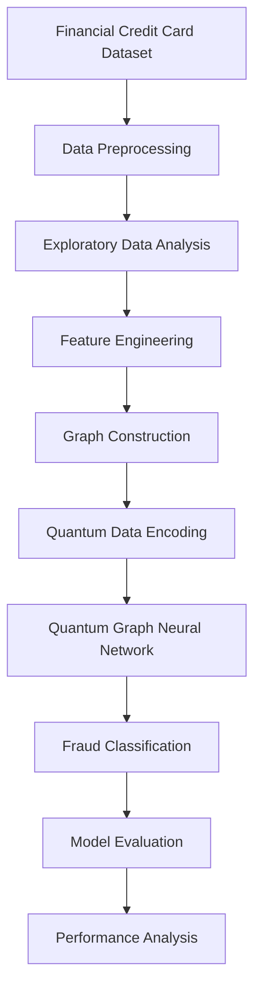

# Financial Credit Card Fraud Detection Using Quantum Graph Neural Networks

  <strong>Master's Thesis | Quantum Computing | Quantum Machine Learning</strong>

  Exploring Quantum Machine Learning techniques for intelligent financial fraud detection.

---

## 1. Overview

Financial fraud detection is a critical challenge in the modern financial ecosystem. With the rapid growth of digital payments and credit card transactions, identifying fraudulent activities accurately and efficiently has become increasingly important.

Traditional machine learning approaches often face challenges when dealing with highly imbalanced datasets and complex relationships between financial transactions.

This research investigates the application of **Quantum Computing and Quantum Machine Learning (QML)** to financial credit card fraud detection, focusing on **Quantum Graph Neural Networks (QGNNs)**.

The research explores the integration of graph-based learning mechanisms and quantum computational techniques to identify suspicious transaction patterns and distinguish fraudulent transactions from legitimate ones.

The primary objective is to investigate the potential of quantum-enhanced graph learning for financial fraud detection and evaluate its performance against relevant classical machine learning approaches.

## 2. Research Objectives

The major objectives of this research are:

- Investigate the application of Quantum Machine Learning in financial fraud detection.
- Explore graph-based representations of financial transaction data.
- Design and implement Quantum Graph Neural Network architectures for fraud classification.
- Investigate quantum-enhanced learning techniques for capturing complex transaction patterns.
- Evaluate quantum-based approaches against classical machine learning models.
- Analyze the potential, limitations, and applicability of quantum computing in financial security.

## 3. Research Architecture

The overall research pipeline consists of the following stages:

### Research Components

| Component | Description |
|---|---|
| Data Collection | Financial credit card transaction dataset |
| Preprocessing | Data cleaning, transformation, and normalization |
| Feature Engineering | Extraction of relevant transaction features |
| Graph Construction | Representing transaction relationships as graph structures |
| Quantum Encoding | Mapping classical information into quantum states |
| Quantum Learning | Applying quantum-enhanced graph learning |
| Classification | Identifying fraudulent and legitimate transactions |
| Evaluation | Measuring model performance |

## 4. Technologies and Frameworks

The research explores the following technologies and frameworks:

| Technology | Application |
|---|---|
| Python | Core implementation |
| Qiskit | Quantum circuit development and simulation |
| Quantum Computing | Quantum information processing |
| Quantum Machine Learning | Quantum-enhanced learning |
| Graph Neural Networks | Graph-based representation learning |
| NumPy | Numerical computation |
| Pandas | Data manipulation |
| Scikit-learn | Classical machine learning and evaluation |
| Matplotlib | Data visualization |

## 5. Methodology

### 5.1 Data Preprocessing

The financial transaction dataset undergoes preprocessing to prepare it for machine learning experiments.

The preprocessing stage includes:

- Handling missing and inconsistent values.
- Feature normalization and scaling.
- Encoding categorical features, where applicable.
- Addressing class imbalance.
- Splitting data into training and testing sets.

### 5.2 Graph Representation

Graph representation provides a mechanism for modeling relationships between financial transactions.

A graph can be represented as:

\[
G = (V,E,X)
\]

Where:

- \(V\): Set of graph nodes.
- \(E\): Set of edges representing relationships.
- \(X\): Node feature matrix.

This representation enables the learning process to consider transaction relationships alongside individual transaction characteristics.

### 5.3 Quantum Data Encoding

Quantum data encoding transforms classical information into quantum states that can be processed using quantum circuits.

A general quantum state representation is:

\[
|\psi(x)\rangle = U(x)|0\rangle^{\otimes n}
\]

Where:

- \(x\): Classical input features.
- \(U(x)\): Quantum encoding operation.
- \(n\): Number of qubits.

### 5.4 Quantum Graph Neural Network

The central focus of this research is the implementation and investigation of Quantum Graph Neural Networks.

QGNNs explore the combination of graph-based learning mechanisms and quantum computational operations.

The research investigates whether quantum-enhanced representations can contribute to learning complex patterns in financial transaction networks.

### 5.5 Fraud Classification

The classification stage aims to distinguish between:

- Legitimate transactions.
- Fraudulent transactions.

The model learns from transaction features and graph representations to identify potentially fraudulent activities.

## 6. Model Evaluation

The following metrics are relevant to evaluating fraud detection performance:

| Metric | Description |
|---|---|
| Accuracy | Overall classification correctness |
| Precision | Proportion of predicted fraud cases that are actually fraudulent |
| Recall | Proportion of actual fraudulent cases correctly identified |
| F1-Score | Harmonic mean of precision and recall |
| Confusion Matrix | Analysis of classification errors |
| ROC-AUC | Classification discrimination capability |

For financial fraud detection, precision and recall are particularly important because false positives and false negatives have different financial consequences.

## 7. Research Contributions

This research investigates the intersection of three important domains:

**1. Financial Security**

Exploring intelligent computational approaches to financial credit card fraud detection.

**2. Graph Neural Networks**

Investigating relational representations of financial transaction data to capture complex patterns and dependencies.

**3. Quantum Machine Learning**

Exploring quantum-enhanced approaches to graph-based learning and financial classification problems.

The research contributes to the broader exploration of quantum machine learning applications in financial technology and intelligent fraud detection systems.

## 8. Limitations and Future Research

Potential directions for further research include:

- Investigating more scalable quantum graph learning architectures.
- Exploring hybrid quantum-classical learning approaches.
- Evaluating models using larger and more diverse financial transaction datasets.
- Investigating quantum advantage through rigorous comparisons with classical baselines.
- Exploring deployment possibilities on real quantum hardware.
- Improving computational efficiency and model scalability.
- Investigating explainability in quantum-based fraud detection systems.

## 9. Academic Information

| Attribute | Details |
|---|---|
| Research Type | Master's Thesis |
| Research Domain | Quantum Machine Learning |
| Application Domain | Financial Fraud Detection |
| Core Research Area | Quantum Graph Neural Networks |
| Quantum Framework | Qiskit |
| Publication | Proceedings of the 18th IOE Graduate Conference |

### Thesis Title

**Financial Credit Card Fraud Detection System Using Quantum Graph Neural Network**

## 10. Author

**AI/ML Engineer | Quantum Machine Learning Researcher**

Research Interests:

- Artificial Intelligence and Machine Learning
- Quantum Computing
- Quantum Machine Learning
- Graph Neural Networks
- Financial Technology
- Hybrid Quantum-Classical Algorithms

---

  <strong>Exploring the Future of Financial Security Through Quantum Computing.</strong>

